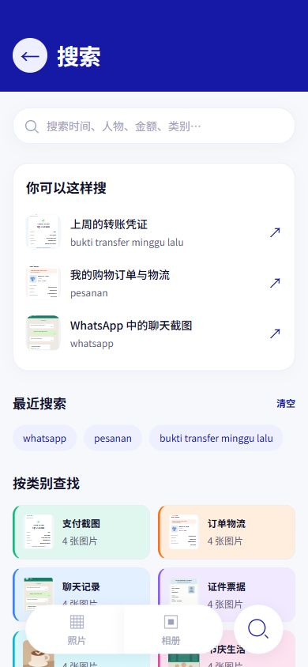

# GalleryGo

你的每个重要瞬间，即刻找到。

在线 Demo：https://llingqi77-tech.github.io/GalleryGo/

网页更新推送到 `main` 后，GitHub Actions 会先运行测试，再自动发布到 GitHub Pages。

面向印尼场景的智能图库静态 H5 Demo，采用 TECNO OCEAN BLUE `#1619A6` 品牌色与 `#4D7CFF` 交互强调色。

## 项目内容

- [完整源码](gallerygo-demo/)：HTML、CSS、原生 JavaScript、本地 JSON 与 24 张示例图片。
- [完整 ZIP 下载](GalleryGo-H5-Demo-搜索布局更新版.zip)：包含源码、启动器、测试及验收截图。
- [运行与素材替换说明](gallerygo-demo/README.md)。
- [最新搜索页验收](gallerygo-demo/verification/搜索发现页验收.md)。

## 快速运行

Windows 安装 Python 3 后，打开 `gallerygo-demo` 文件夹，双击 `启动预览.bat`。

也可执行：

```powershell
cd gallerygo-demo
python start-preview.py
```

电脑浏览器访问 `http://127.0.0.1:8787/`；同一可互访 Wi-Fi 下，手机访问启动窗口打印的电脑 IP 地址。

无框架、无构建、无业务后端、无上传、无登录。Python 仅提供静态文件。

## 已实现的演示

- 印尼语预设语义映射搜索、带缩略图的搜索示例与本地最近搜索。
- 六类任务相册与按日期排列的照片时间轴。
- 全屏图片详情、新建标签及关联图片批量打标。
- 相册类别下方的独立相似图清理，支持推荐保留、演示隐藏与撤销。
- 本地资源和安全上下文的 Service Worker 缓存。

当前为前端交互演示，OCR、分类、相似关系和学习结果来自本地 JSON 预设；未接入真实 AI。离线刷新需先完成缓存，普通手机局域网 HTTP 不承诺离线重新打开。

## 验证

```powershell
cd gallerygo-demo
node --test tests/*.test.cjs
node --check script.js
node --check sw.js
```

19 项测试通过。已检查 360px / 390px 页面布局；历史及最新浏览器验收记录、截图见 `gallerygo-demo/verification/`。

## 最新搜索页面


